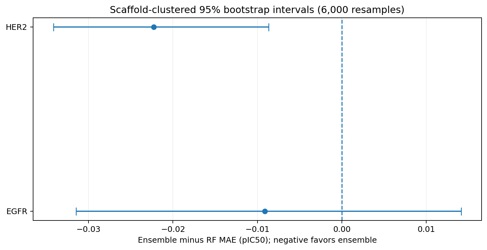
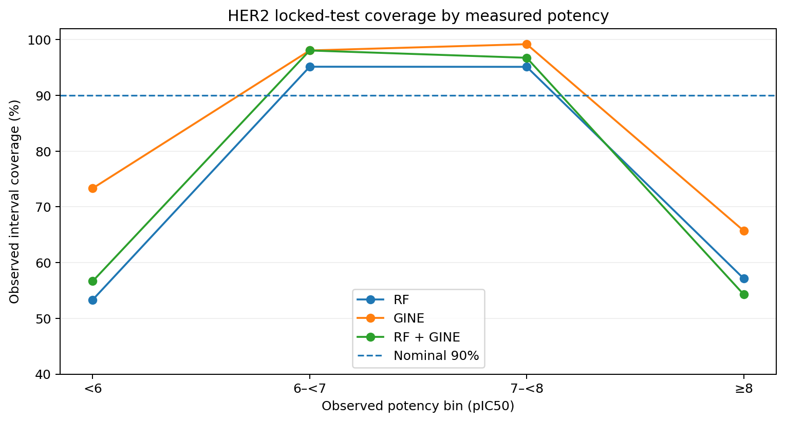
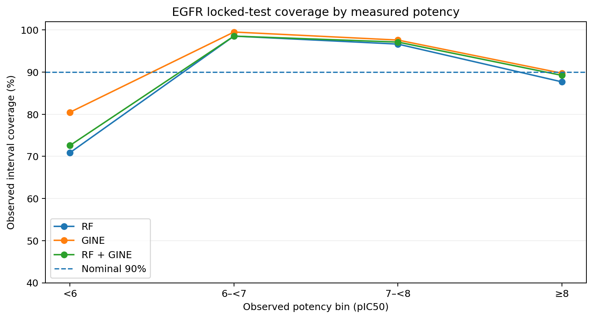

# M3.8 — Final Scientific Analysis: Locked-Test Scaffold Generalization

**Project:** AI-Driven De Novo Molecular Design and Virtual Screening for Cancer Drug Discovery — EGFR/HER2 predictor benchmark  
**Status:** Post-hoc statistical and error analysis of the **completed, one-time locked-test run**; no retraining, recalibration, model selection, or additional test scoring.  
**MLflow run:** `3cb6ed73b086444097ca4bfd69bb348f`  
**Frozen protocol SHA-256:** `54b706b783eebbb999780805ffe355b5cc35a027dd0d6a418164ccd2bf690fbd`  
**Test population:** 1,087 molecules / 391 unique scaffold groups; EGFR 902 labeled across 330 scaffolds; HER2 321 labeled across 120 scaffolds. The 136 dual-measured molecules span 58 scaffold groups.

## Executive summary

The frozen **75% Morgan RF + 25% GINE** ensemble yielded lower test-set pIC50 MAE than RF alone for EGFR (0.7244 vs 0.7335) and HER2 (0.5243 vs 0.5466), and higher regression-derived dual-activity average precision (0.8908 vs 0.8678). **Standalone GINE did not beat RF on either target's test MAE.** The ensemble's HER2 gain is supported more consistently across sampled scaffolds than its EGFR gain. Post-hoc scaffold-clustered bootstrap intervals include zero for the EGFR MAE and dual-AP changes; one large, weak-potency scaffold largely explains the pooled EGFR improvement. Thus the finding is *suggestive but not universal*: complementary graph information can help the combined predictor, but held-out performance remains dependent on chemical family and target.

## 1. Fixed evaluation design

- **Inputs:** frozen 47-epoch, 3-layer, 128-dimension edge-aware GINE; tuned Morgan-radius-2/2,048-bit RF regressors; fixed 75/25 *prediction-space* ensemble.
- **Measured outcomes:** pIC50 for accepted EGFR/HER2 labels; paired dual activity defined strictly as both pIC50 > 6; dual ranking score is `min(pred_EGFR, pred_HER2)`.
- **Uncertainty:** symmetric 90% single-target split-conformal prediction intervals learned before test, unchanged throughout this analysis. Separate target-specific intervals do **not** guarantee 90% simultaneous joint coverage.
- **Independence controls:** original scaffold-held-out split, frozen model and calibration hashes, one-time test-consumption record; no parameter adaptation after unlocking test labels.

## 2. Final results

| Target and metric | Morgan RF | GINE | RF75/GINE25 |
|---|---:|---:|---:|
| EGFR MAE (pIC50; lower better) | 0.7335 | 0.8103 | **0.7244** |
| EGFR Spearman (higher better) | 0.8260 | 0.7375 | **0.8284** |
| HER2 MAE (pIC50; lower better) | 0.5466 | 0.5548 | **0.5243** |
| HER2 Spearman (higher better) | 0.6493 | 0.6719 | **0.6888** |
| Dual activity AP (136 paired; higher better) | 0.8678 | 0.8619 | **0.8908** |
| EGFR nominal-90% interval coverage | 86.8% | **90.8%** | 87.8% |
| EGFR full interval width (pIC50) | **2.873** | 3.645 | 2.905 |
| HER2 nominal-90% interval coverage | 83.2% | **90.3%** | 85.0% |
| HER2 full interval width (pIC50) | **1.943** | 2.430 | 1.946 |

The paired class prevalence was **95/136 = 69.9% dual-active**, so reported AP should be interpreted against this relatively high prevalence, rather than assuming balanced classes.

## 3. Scaffold-clustered paired uncertainty analysis

**Method:** 6,000 bootstrap replicates (seed 714). For each target, sample the held-out scaffold IDs with replacement and include all labeled molecules within each sampled scaffold. Recompute the paired difference in average absolute error (ensemble minus RF). For paired dual activity, resample its 58 scaffold groups and recompute AP differences on the duplicated pooled observations. Percentile intervals are **exploratory and conditional on the observed set of scaffold families**, not distribution-free guarantees, formal significance tests, or independent model selection.

| Comparison | Observed difference | 95% scaffold-bootstrap interval |
|---|---:|---:|
| EGFR ensemble − RF, MAE | **−0.0091** | [−0.0315, +0.0141] |
| HER2 ensemble − RF, MAE | **−0.0223** | [−0.0342, −0.0087] |
| Dual activity ensemble − RF, AP | **+0.0231** | [−0.0141, +0.0601] |
| EGFR GINE − RF, MAE | +0.0768 | [+0.0151, +0.1482] |
| HER2 GINE − RF, MAE | +0.0083 | [−0.0412, +0.0604] |

**Interpretation:** HER2 MAE improvement is relatively robust to scaffold resampling. The EGFR and paired AP gains have intervals crossing zero; report their point estimates with uncertainty rather than claiming a universal gain.

## 4. Error complementarity and dependence

RF and GINE **signed error correlations** are 0.786 (EGFR) and 0.812 (HER2); their absolute-error correlations are 0.637 and 0.743. These models are far from independent. Nevertheless, the ensemble has lower individual absolute error on **458/902 EGFR molecules (50.8%)** and **189/321 HER2 molecules (58.9%)**. GINE alone beats RF molecule-wise on 385/902 (42.7%) EGFR and 166/321 (51.7%) HER2 molecules. Pooling can improve aggregate errors even when one component is inferior overall, but it does not imply the graph model learns a uniquely causal chemical mechanism.

A **leave-one-scaffold-out sensitivity check** gives an important qualification: removing `BM-13cad05ca8f49c…` (93 EGFR measurements, mean measured pIC50 **4.116**) changes EGFR ensemble-minus-RF MAE from **−0.0091** to **+0.0021**, reversing the advantage. HER2 ensemble-minus-RF MAE remains negative when each of its 120 labeled scaffold groups is removed individually (range −0.0233 to −0.0196).

## 5. Difficult scaffold families

Only **15/330 EGFR** and **6/120 HER2** test scaffold groups contain at least 10 labeled molecules. These are **descriptive rankings**, not chemical-cause assignments or conditional coverage guarantees. Smaller groups are retained in the full scaffold CSV but excluded from the main stable-group comparisons.

| Target, scaffold (prefix) | n | Mean measured pIC50 | RF MAE | GINE MAE | Ensemble MAE | Ensemble interval coverage |
|---|---:|---:|---:|---:|---:|---:|
| EGFR `BM-13cad05ca8f49c…` | 93 | 4.116 | 1.418 | 1.254 | 1.311 | 53.8% |
| EGFR `BM-e9ca67cf14a6f…` | 14 | 5.691 | 1.118 | 1.803 | 1.277 | 64.3% |
| HER2 `BM-13cad05ca8f49c…` | 19 | 5.050 | 0.743 | 0.933 | 0.677 | 78.9% |
| HER2 `BM-d1caacdf0df191…` | 24 | 6.711 | 0.663 | 0.581 | 0.609 | 83.3% |

The large EGFR scaffold `BM-13cad05ca8f49c…` accounts for **93 of 902 labels (10.3%)**, and **48 of 119 EGFR RF interval misses (40.3%)**. RF mean signed prediction error there is **+1.253 pIC50**: it substantially overpredicts the potency of this predominantly weak-inhibitor scaffold family. The ensemble reduces but does not eliminate this problem: **43 of its 110 EGFR misses** occur in the same scaffold.

**Chemical-structure requirement:** These uploaded prediction tables contain only hashed scaffold IDs, **not scaffold SMILES**. A chemically interpretable figure requires a verified join against the frozen curated dataset using `structure_id` or `scaffold_group_id`, then drawing the true Bemis–Murcko cores with RDKit. Do not infer scaffold chemistry from hashes alone.

## 6. Potency-dependent undercoverage

Strongly nonuniform coverage appears across observed potency ranges, especially HER2. This is an *outcome-based diagnostic*; the true potency is unknown at screening time, so these bins cannot directly define deployable conditional intervals.

| HER2 measured pIC50 | n | RF coverage | GINE coverage | Ensemble coverage |
|---|---:|---:|---:|---:|
| <6 | 60 | 53.3% | 73.3% | 56.7% |
| 6–<7 | 103 | 95.1% | 98.1% | 98.1% |
| 7–<8 | 123 | 95.1% | 99.2% | 96.7% |
| ≥8 | 35 | 57.1% | 65.7% | 54.3% |

For HER2, weak (<6) and strongly potent (≥8) molecules account for **43/54 RF misses (79.6%)**, **28/31 GINE misses (90.3%)**, and **42/48 ensemble misses (87.5%)**. For EGFR, these two extreme bins account for 109/119 RF misses (91.6%), 77/83 GINE misses (92.8%), and 101/110 ensemble misses (91.8%).

The models often overestimate weak inhibitors and underestimate strong inhibitors, a regression-toward-the-center pattern. Potential causes include molecular feature limitations, potency distributions, assay variability, and scaffold representation; these mechanisms were **not proven** by this analysis.

## 7. Calibration trade-off and joint target uncertainty

GINE has empirical single-target coverage closest to 90% on both test targets, but its intervals are materially wider than RF's: **3.645 vs 2.873** pIC50 units on EGFR and **2.430 vs 1.943** on HER2. The ensemble offers better point accuracy but misses nominal target coverage (87.8% EGFR, 85.0% HER2). Calibration success and predictive accuracy are therefore distinct outcomes.

Among 136 paired-labeled molecules, observed simultaneous coverage of both separate intervals is **72.1% RF**, **81.6% GINE**, and **75.0% ensemble**. These individual-target conformal intervals were **not jointly calibrated**; do not describe them as 90%-joint-confidence regions.

## 8. Limitations and defensible conclusion

1. **Scaffold shift and representativeness:** Frozen scaffold-group separation helps avoid scaffold identity leakage but does not imply arbitrary fingerprint-cluster or prospective chemical-space generalization. A few larger scaffold groups have disproportionate influence.
2. **Calibration:** Nominal marginal coverage depends on exchangeability and valid separation of calibration/model fitting; previous RF selection/calibration reuse limits unconditional guarantees. Coverage on the observed test sample is empirical; scaffold-conditional coverage is not guaranteed.
3. **Small paired sample and imbalance:** Dual AP uses only 136 paired molecules (95 positive); high prevalence and 58 scaffold clusters complicate extrapolation and the bootstrap CI spans zero.
4. **Single-run graph training:** GINE random seed and the fixed 47-epoch refit are frozen; between-seed uncertainty and prospective assay noise were not experimentally quantified.
5. **Model comparison:** Post-hoc CIs are descriptive estimates after a single frozen test run and should not be used to select new weights, recalculate calibration widths, or run further model experiments against this test set.
6. **No biological validation:** IC50 predictions and structural-scaffold associations are computational hypotheses, not proof of selectivity, efficacy, tolerability, or clinical utility.

**Final answer to the capstone's core question:** On the one-time scaffold-held-out test, standalone GINE did **not** improve target-specific MAE over a Morgan RF. The prespecified 75/25 RF/GINE ensemble **did** produce modest lower observed MAE on both targets and higher dual-activity AP. A scaffold-aware post-hoc analysis suggests the HER2 MAE improvement is more stable than the EGFR or dual-ranking gains. Strong structural-family variation and poor coverage at potency extremes remain major limitations. The locked-test protocol is **consumed** and should not be rerun or used for further tuning.

## Analysis provenance

- Original final test run: `3cb6ed73b086444097ca4bfd69bb348f`; protocol hash `54b706b783eebbb999780805ffe355b5cc35a027dd0d6a418164ccd2bf690fbd`.
- The original test metrics, test predictions, scaffold table, and one-time-consumption marker were read; no model fitting, re-optimization, or test re-scoring by checkpoints.
- Statistics: deterministic NumPy seed `714`, `6,000` paired scaffold-bootstrap resamples, percentile limits at 2.5%/97.5%, original test observations held unchanged.
- Companion data: `M3_8_scaffold_bootstrap_comparisons.csv`, `M3_8_locked_test_scaffold_diagnostics.csv`, `M3_8_locked_test_coverage_audit.csv`, `M3_8_leave_one_scaffold_out_sensitivity.csv`, `M3_8_posthoc_analysis_summary.json`.

### Input file SHA-256 hashes

| File | SHA-256 |
|---|---|
| `M3_7d_locked_test_metrics.json` | `8cfbde196db7ddf58ec096e09ea01f846ddf1e8da2a541ee54968302056a914b` |
| `M3_7d_locked_test_predictions.csv` | `18decdc6f1b62aee9e8c67d81611d6e8a0e7fd791a774b45d42891e179837a8f` |
| `M3_7d_locked_test_scaffold_coverage.csv` | `f35fb8956a59f25fd2f64c297657510ef10bbd5e4b49fe07edc2fe8e293f986f` |
| `M3_7d_LOCKED_TEST_CONSUMED.json` | `69aaff876e03dbba313cdf02dc3f42079527d6cfcb355cff6c7bd586bd8e0372` |
| `M3_7d_frozen_test_protocol.json` | `54b706b783eebbb999780805ffe355b5cc35a027dd0d6a418164ccd2bf690fbd` |
